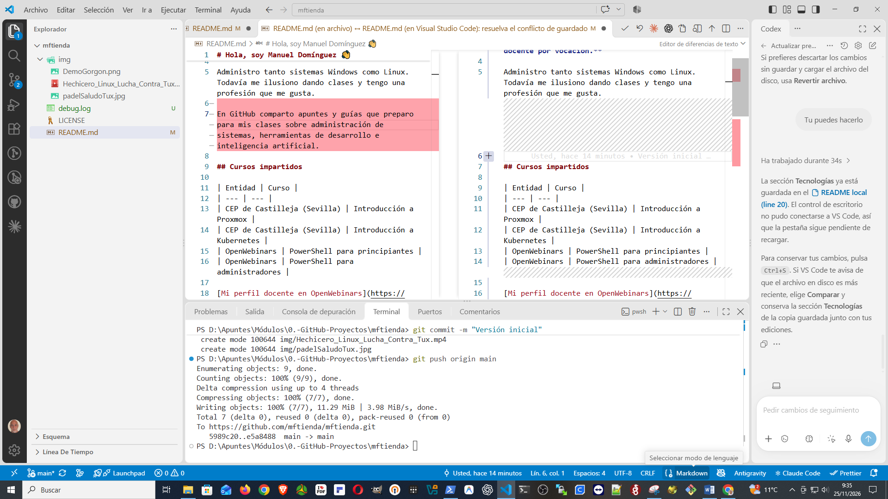

# Hola, soy Manuel Domínguez 👋

**Físico de formación, informático de profesión y docente por vocación.**

Administro tanto sistemas Windows como Linux. Todavía me ilusiono dando clases y tengo una profesión que me gusta.

## Cursos impartidos

| Entidad | Curso |
| --- | --- |
| CEP de Castilleja (Sevilla) | Introducción a Proxmox |
| CEP de Castilleja (Sevilla) | Introducción a Kubernetes |
| OpenWebinars | PowerShell para principiantes |
| OpenWebinars | PowerShell para administradores |

[Mi perfil docente en OpenWebinars](https://openwebinars.net/profesores/manuel-dominguez/)

## Materiales para el aula

| Repositorio | Contenido |
| --- | --- |
| [VS Code](https://github.com/mftienda/VScode) | Extensiones, configuración y sincronización entre equipos. |
| [Inteligencia artificial](https://github.com/mftienda/IA) | Buscadores, fundamentos de IA, uso responsable, agentes y modelos locales. |
| [GitHub Pages](https://github.com/mftienda/Pagina-Web-Github) | Guía para publicar una web desde un repositorio de GitHub. |

## Fuera del aula

En mi tiempo libre juego al pádel. En esta imagen, Tux, la mascota de Linux, también se anima a entrar en la pista.

Mi serie favorita es **Stranger Things**. También comparto dos piezas de fantasía digital.

- [Ilustración de fantasía](img/DemoGorgon.png)
- [Vídeo del hechicero de Linux y Tux](img/Hechicero_Linux_Lucha_Contra_Tux.mp4)
