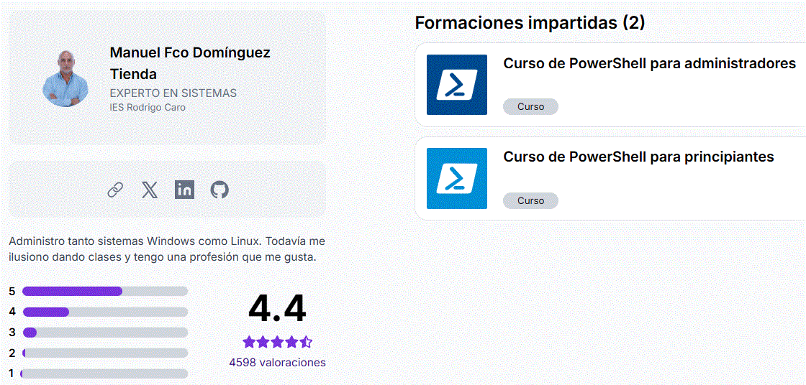
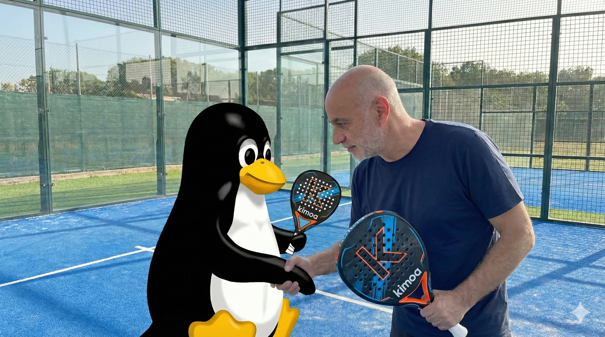
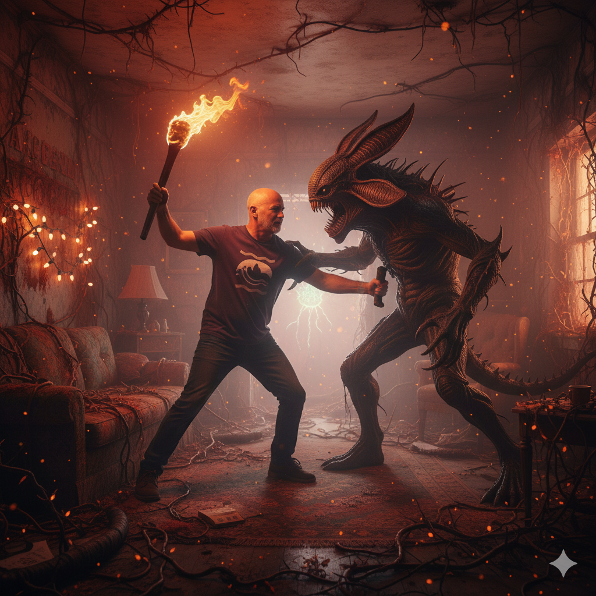

# Hola, soy Manuel Domínguez 👋

**Físico de formación, informático de profesión y docente por vocación.**

Administro tanto sistemas Windows como Linux. Todavía me ilusiono dando clases y tengo una profesión que me gusta.

## Últimos cursos impartidos

| Entidad | Curso |
| --- | --- |
| CEP de Castilleja (Sevilla) | Introducción a Proxmox |
| CEP de Castilleja (Sevilla) | Introducción a Kubernetes |
| OpenWebinars | PowerShell para principiantes |
| OpenWebinars | PowerShell para administradores |

[Mi perfil docente en OpenWebinars](https://openwebinars.net/profesores/manuel-dominguez/)

## Materiales para el aula

<!-- MATERIALES:INICIO -->

| Repositorio | Contenido |
| --- | --- |
| [Mi-GitHub-Actions](https://github.com/mftienda/Mi-GitHub-Actions) | Mi GitHub Actions |

<!-- MATERIALES:FIN -->

[Ver todos mis repositorios](https://github.com/mftienda?tab=repositories)

## Fuera del aula

En mi tiempo libre juego al pádel. En esta imagen, Tux, la mascota de Linux, también se anima a entrar en la pista.

Mi serie favorita es **Stranger Things**. Aquí comparto una ilustración de fantasía.

